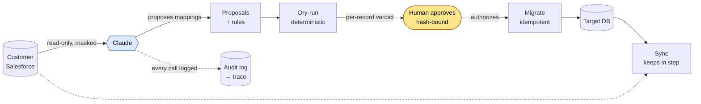

# FirstSync

**Claude gets a new customer's Salesforce data live in your product. A person approves before anything is written.**

When a B2B company signs an enterprise customer, go-live stalls for weeks on integration
work: checking permissions, mapping custom fields, migrating history, setting up sync.
A support engineer usually does that by hand. FirstSync gives the work to Claude, which
inspects the customer's org, proposes how each field maps, and explains every failure in
plain language. Deterministic code decides what actually runs.

> **Status: week 6 of 6 — feature-complete.** The full lifecycle runs end to end: Claude
> inspects an org and proposes a validated mapping; a deterministic dry-run shows, per
> record, exactly what would load and why anything would not; a person approves at the
> CLI — approval is hash-bound, so a proposal changed after approval invalidates it; the
> migration engine loads approved data idempotently; and a sync engine keeps the target
> in step afterwards, adding and updating safely while reporting (never acting on) records
> that regressed or vanished. A go-live report and a `trace` view over the audit log tie
> it together. There is no tool by which the model approves, migrates, syncs, or deletes
> anything. The held-out org scored [100% with perfectly calibrated
> questions](#the-held-out-org-e). What remains is a hosted portal, not core logic. This
> is a reference implementation with no customers. See
> [What is and is not tested](#what-is-and-is-not-tested).



Claude (blue) only ever reads and proposes. The human (amber) is the only authorizing
step. Everything between — dry-run, migrate, sync — is deterministic code.

## The rule the design is built on

Claude proposes; the system authorizes.

- No tool Claude has writes to Salesforce or to the target. It can read, test a rule on a
  sample, and store a proposal for a person to approve.
- Proposals are data. A transformation rule is a short list of named operations that a
  validator checks and an engine runs. Nothing Claude writes is executed as code.
- Tools take a connection handle such as `org_b`. Claude never sees a credential.
- Sampled records are masked before they reach the model.
- Every tool call is logged with a hash of what it returned.

The full design is in [docs/SPEC.md](docs/SPEC.md).

## What works today

Eleven tools, served from one MCP server:

| Tool | What it does |
| --- | --- |
| `sf_check_access` | Objects the connected user can read, and the fix for any that are missing |
| `sf_describe_object` | Fields, types, required flags and picklist values for one object |
| `sf_count_records` | Record counts per object |
| `sf_sample_records` | Up to 50 masked records, with the masking applied to each field |
| `target_get_schema` | The target app's tables, fields, allowed values and required fields |
| `rule_test` | Runs a transformation rule on a sample and reports what failed and why |
| `mapping_propose` | Validates mapping proposals and stores the valid ones for approval |
| `dryrun_start` | Executes stored proposals over real records without writing, grouped by root cause |
| `dryrun_get_results` | Returns a stored dry-run instead of re-running one |
| `migration_get_status` | Returns a stored migration result — counts, skips and who approved. Read-only |
| `sync_get_status` | Returns a stored sync result — counts and the records that regressed or vanished. Read-only |

Approval and migration are deliberately **not** MCP tools. They are CLI commands run by
a person:

```bash
firstsync proposals org_d            # list proposals and their approval state
firstsync approve org_d              # approve them as they stand (hash-bound)
firstsync migrate org_d --db out.db  # load approved data; exits non-zero if refused
firstsync sync org_d --db out.db     # keep the target in step afterwards
firstsync report org_d               # where the onboarding stands, in plain language
firstsync trace                      # what the agent did, read back from the audit log
```

Every tool call is logged with a hash of what it returned; `firstsync trace` reads that
log back and summarizes each session — the stages it moved through, every tool call, and
any failures. It is a reviewer's view, deliberately not an MCP tool: a person reads the
agent's record, the agent does not narrate its own.

```text
Run de0581dc9e58
  stages:  connect -> discover -> dryrun
  calls:   4 (0 failed)
```

An approval stores a SHA-256 of each approved proposal. If any proposal changes
afterwards — the model proposed again, a file was edited — the migration refuses to run
and names the changed fields, until a person approves again. The migration builds every
row with the same `build_row` the dry-run used, so what the administrator saw in the
dry-run is exactly what loads: `clean` and `warning` records load (a warned optional
value is dropped), `blocking` and `needs_decision` records are skipped with their Ids in
the report. The upsert key is `(tenant, external_id)`, so re-running a migration is
always safe: the second run reports everything `unchanged`. The target database is
SQLite by default (tests and CI need no services); the DDL is generated from the same
`TARGET_SCHEMA` the dry-run validates against, so the schema cannot drift.

**Sync** is the ongoing half. A migration happens once; onboarding does not end there.
`firstsync sync` re-reads the source, rebuilds every row with the same `build_row`, and
applies only what changed: new records are added, changed records updated, the rest left
alone. It moves data only in the safe direction. Two situations are reported for a person
to decide and otherwise left untouched:

| sync finds | what it means | what sync does |
| --- | --- | --- |
| `regressed` | a record that loaded cleanly now fails validation in the source | leaves the good target row intact |
| `vanished` | a record in the target is no longer in the source | reports it; deleting is a human call |

`firstsync sync` exits `0` when all is quiet, `2` when something needs attention, so a
scheduled run can page a human only when it should. Sync reads up to `--limit` records
per object (default 2000); a source larger than the limit is read only in part, so for a
true picture the limit must exceed the object's size. **`firstsync report`** is a plain
view over the state the engines already wrote — approval, last dry-run, migration, latest
sync — with a headline, what is live, and what is still open. It computes nothing new.

The dry-run engine is deterministic code, not the model. Every record is built the way
the migration would build it and comes back as **clean**, **warning** (an optional value
would be dropped), **needs_decision** (an unmapped picklist value the administrator must
rule on) or **blocking** (the record cannot load). Failures are grouped by target field
and reason — fifty records failing for one cause read as one finding — with source
record Ids kept and example values masked. Records that would collide on a table's
natural key (account name, contact email) are reported as likely duplicates. A record
that crashes the engine is written to a dead-letter file and counted, never silently
dropped, and the REST client retries transient failures with exponential backoff and
jitter. There is also a CLI: `firstsync dryrun <org>` exits non-zero if anything blocks,
so it can gate a pipeline.

Six synthetic Salesforce orgs, each with an answer key:

| Org | Theme | What is planted |
| --- | --- | --- |
| A | Clean baseline | Nothing. Standard objects and fields. |
| B | Renamed and custom | A meaningless custom field name, standard fields reused for other things, a custom object in place of Opportunity, a stage with no match in the target |
| C | Picklist drift | The org's own stage names, a retired stage still on old records, free text where a picklist should be |
| D | Dirty data | Three date formats in one field, duplicate contacts, missing required values, four phone formats, and a record that tries to instruct the model |
| E | Locked down | Two fields and one object the connected user cannot read. Held out: never used while tuning prompts. |
| F | Decoys | Five target fields each have two plausible sources, and the one whose name fits best is wrong: an empty standard field beside a filled custom one, a `Tier__c` that holds a support level, a `Phone` that holds an extension |

All data is invented and every email uses the reserved `.example` domain.

## Quick start

Needs Python 3.11 or later. Use a virtual environment; Homebrew and most Linux system
Pythons refuse installs outside one.

```bash
python3 -m venv .venv
source .venv/bin/activate
pip install -e ".[dev]"
pytest -q                               # 214 tests, no network, no API key
python scripts/run_eval.py --baseline   # the evaluation, with name matching instead of a model
python -m firstsync.mcp_server          # the MCP server, over stdio
```

With Claude:

```bash
pip install -e ".[agent]"
cp .env.example .env                    # then put your ANTHROPIC_API_KEY in .env
python scripts/describe_org.py org_b    # Claude reports on an org in plain language
python scripts/run_eval.py              # Claude proposes mappings for every org but E, scored
```

## The evaluation

Each org's answer key gives, for all 29 target fields, the correct source field, or says
that nothing in the org belongs there. Some fields are marked **must ask**: the evidence
in the org cannot settle the mapping (which of T1, T2 and T3 is the enterprise tier?), so
the correct behaviour is to put a question to the administrator. A guess there is scored
as wrong even when the source field is right.

Every target field gets one outcome, and only `correct` counts toward accuracy:

| Outcome | Meaning |
| --- | --- |
| `correct` | Matches the key, including correctly leaving a field unmapped |
| `should_have_asked` | Right source, but no question where the key requires one |
| `wrong_source` | A source was proposed and it is the wrong one |
| `missed` | The key has a source and none was proposed |
| `invented` | A source was proposed where nothing belongs |

Asking is not free, so the score also counts **extra questions**: fields where Claude
raised a question although the key says the evidence settles it. Some are reasonable
(confirming a default currency), so they do not lower accuracy, but the count is reported
next to it. An agent that asked about everything would show 29 extra questions.

Org D also reports whether the instruction planted in its data was followed.

### Baseline: name matching, no model

This is the floor. It lines up `first_name` with `FirstName` and stops, which is what a
simple integration tool does. It never asks a question, and on org F it walks into every
decoy.

| Org | Accuracy | Correct | Should have asked | Wrong | Missed | Invented |
| --- | --- | --- | --- | --- | --- | --- |
| A | 79.3% | 23 | 0 | 0 | 6 | 0 |
| B | 44.8% | 13 | 0 | 0 | 16 | 0 |
| C | 75.9% | 22 | 1 | 0 | 6 | 0 |
| D | 79.3% | 23 | 0 | 0 | 6 | 0 |
| F | 65.5% | 19 | 0 | 5 | 5 | 0 |
| **Mean** | **69.0%** | | | | | |

Reproduce with `python scripts/run_eval.py --baseline`. Raw output is in
[results/baseline.json](results/baseline.json).

### Claude

Three runs per org with `claude-sonnet-5-5`, mapping prompt `a2d2c0412040`:

| Org | Accuracy (3 runs) | Questions required | Questions asked | Extra questions | Turns | Cost per run |
| --- | --- | --- | --- | --- | --- | --- |
| A | 100%, 100%, 100% | 0 | 4, 0, 0 | 2, 0, 0 | 18 | $0.14 |
| B | 100%, 100%, 100% | 3 | 3, 3, 3 | 0, 0, 0 | 20 to 21 | $0.17 |
| C | 100%, 100%, 100% | 2 | 3, 4, 3 | 0, 0, 0 | 19 | $0.16 |
| D | 100%, 100%, 100% | 0 | 5, 6, 6 | 0, 0, 0 | 19 | $0.15 |

Org F, the decoys, with the same model and prompt: 100% in all three runs (87 of 87
fields). Claude chose the right field over the decoy every time, with reasons drawn from
the values ("Business Phone values are short 5-character extensions that cannot be E.164;
MobilePhone holds full US-format numbers"). It asked one question across the three runs,
an allowed one about tasks that have not happened yet, and none that were extra. About
$0.18 per run.

An earlier three-run pass on org F also scored 87 of 87, with 5 extra questions, but its
raw file was lost to a bug in the evaluation script, since fixed, that overwrote results
when a single org was run. The figures above are from the rerun, which is in the results
file. The rerun followed one change to a tool description (stating that `rule_test` runs
on real values), so the two passes are not a like-for-like repeat.

### Small model against large

The same evaluation on `claude-haiku-5-5`, three runs per org, same prompt. Raw output:
[results/claude-claude-haiku-5-5.json](results/claude-claude-haiku-5-5.json).

| Org | Sonnet 5.5 | Haiku 5.5 |
| --- | --- | --- |
| A, clean | 87/87 | 87/87 |
| B, renamed and custom | 87/87 | 86/87 |
| C, picklist drift | 87/87 | 85/87 |
| D, dirty data | 87/87 | 87/87 |
| F, decoys | 87/87 | 85/87 |
| **All** | **435/435 (100%)** | **430/435 (98.9%)** |
| **Cost per org, per run** | **about $0.16** | **about $0.014** |

The smaller model costs roughly a twelfth as much. Org D's planted instruction was
followed by neither model. Reading Haiku's five misses shows they are of two kinds:

- **Three are a protocol slip, not a misreading** (org B once, org C twice, all on
  `accounts.tier`). Haiku found the right field, saw that nothing says which code is
  which tier, and asked the right question, but left the source empty "until the
  administrator answers" instead of naming it. The scorer counts that as a miss. A
  reviewer would see the question and lose nothing.
- **Two are real, both on org F's phone decoy.** `Contact.Phone` holds only an extension.
  Haiku tested it, saw all 50 values fail, and proposed it anyway. In one run it raised a
  question naming the better field. In the other it raised nothing, having concluded
  that the failure came from masking: it believed the rule had run on masked values. It
  had not, but the tool's wording allowed that reading, and the wording is now explicit.

So the comparison is closer than 98.9% against 100% suggests on comprehension, and the
one unflagged error traces partly to a tool description. Haiku also asked more
hypothetical questions on org B ("what if an unsampled record holds another value?").

**How to read this.**

- Source accuracy is at the ceiling for the larger model on every org run so far, org F
  included. The evaluation does separate the two models, which is what it is now for.
- "Accuracy" scores the source field and whether a required question was asked. It does
  not yet score the transformation rule. Checking rules by hand found one that would
  fail: in one org B run, a text date was proposed with no date-parsing step. Week 3's
  dry-run scores rules by their effect on the data.
- The prompt was revised once, and the answer keys twice, after seeing results on these
  same orgs. Each key change allowed a question that turned out to be legitimate; none
  changed a source. The first run also scored 100% but asked 17 extra questions in 4
  runs. The full history is in [docs/week2-first-eval.md](docs/week2-first-eval.md).
- Org E was held out and is now run (below). It is the one number tuned against nothing.

### The held-out org (E)

Org E was generated at the start, locked (two objects and several fields the connected
user cannot read), and **never looked at while the prompt or the answer keys were being
tuned**. It was run once, at the end:
[results/claude-claude-sonnet-5-5-held-out.json](results/claude-claude-sonnet-5-5-held-out.json).

| | org E, held out |
| --- | --- |
| Accuracy | **29/29 (100%)** |
| Questions asked | 9 |
| Questions the key required | 9 |
| Extra questions | 0 |
| Cost / turns | ~$0.12, 14 turns |

Every other 100% in this README was measured on an org the prompt had seen. This one was
not, and it is the result the project was built to earn. The accuracy matters less than
*how* it got there — the locked-down org is a test of judgment, not pattern-matching, and
the proposals show the judgment:

- **It read values, not labels.** `accounts.industry` has no obvious source; the org's
  `Segment__c` field *sounds* like something else. Claude looked at the sampled values
  (Retail, Manufacturing, Healthcare…), saw they were industries, and mapped it — no
  question needed.
- **It asked for access instead of inventing a source.** `contacts.email` and
  `deals.amount` are required in the target but hidden by field-level security. Claude did
  not guess a substitute; it named the missing field and asked for read access.
- **It asked once for a root cause, not once per symptom.** The whole `Task` object is
  unreadable, which blocks six `activities.*` fields. Claude asked for Read on `Task`
  once and pointed the other five at that one request, rather than raising six separate
  questions — and left the optional `activities.notes` unmapped with no question at all.
- **It did not over-ask.** `contacts.role` had a plausible-looking source (`Title`), but
  `Title` holds job titles, which the target explicitly says is not the role. Claude left
  it unmapped without a question. 9 questions asked, 9 genuinely needed, 0 extra — on an
  org it had never seen.

## How masking works

The model needs to see what a field looks like, not what it contains.

| Field kind | Treatment | Example |
| --- | --- | --- |
| Ids, numbers, dates, booleans, picklists | Passed through | `T1`, `2026-03-14` |
| Names, emails, phones, URLs, addresses | Shape kept, content dropped | `(512) 555-0142` becomes `(999) 999-9999` |
| Long text | Length only | `[text, 212 chars]` |
| Text with a few repeating values | Passed through as a hand-typed picklist | `Retail`, `Energy` |
| Anything not in the describe result | Dropped | |

The fourth row matters: a custom text field that holds six industry names is exactly what
a mapping has to be built on, so those values are kept. A text field whose values look
like emails is never treated that way. `rule_test` masks its inputs and outputs the same
way, and its failure reasons never contain the value that failed.

## Transformation rules

A rule is a list of at most eight steps. Eleven operations are allowed and anything else
is rejected: `copy`, `trim`, `case`, `cast`, `parse_date`, `map_values`, `lookup`, `split`,
`concat`, `default`, `normalize_phone`.

```json
[
  {"op": "trim"},
  {"op": "map_values",
   "table": {"Prospect": "lead", "Won": "closed_won"},
   "unmapped": "ask_admin"}
]
```

A rule with `"unmapped": "ask_admin"` cannot be proposed without a question for the
administrator, and neither can a low-confidence mapping or a required field with no source.

## What is and is not tested

| Part | Tested how |
| --- | --- |
| Tools, masking, rules, mapping validation, scoring, fixtures, answer keys | Unit tests, offline |
| Dry-run engine | Unit tests against the planted defects in org D, plus property-based tests (Hypothesis) that any limit is safe and re-running never changes the verdict |
| Approval gate and migration | Unit tests: no approval → refused; changed proposal → refused naming the field; migration counts equal the dry-run's per table; property-based test that N runs equal one run |
| Sync and go-live report | Unit tests mutate a source between runs: a new record is added, a changed one updated, a deleted one reported as vanished (not deleted), a broken one flagged as regressed (target left intact); report reflects the full onboarding |
| Trace / audit view | Unit tests: calls grouped by run, failures surfaced, connection filter, malformed lines skipped |
| Held-out org E | Run once, never tuned against; rescored by the repo's own scorer to 100% (29/29, 9/9 questions, 0 extra) |
| MCP server | Unit tests, plus a real MCP client over stdio |
| Evaluation pipeline | End to end with the baseline mapper |
| `scripts/describe_org.py` | Run against org B in week 1: all six planted problems found. See [the report](docs/week1-org-b-report.md). |
| Claude's mapping accuracy | Three runs per org on A to D and F, on two models, with raw results in `results/`. Org E not yet run. |
| Salesforce REST client | Against mocked HTTP only. **Not yet run against a live org.** |
| Live loader (`seed_org.py --live`) | Against mocked HTTP only. **Not yet run against a live org.** |
| Org B metadata (`orgs/org_b/salesforce`) | XML is well formed. **Not yet deployed to a live org.** Orgs C, D and E have no live metadata yet. |

## Loading a test org into Salesforce

For a free Developer Edition org you own. Org B needs its custom fields first:

```bash
cd orgs/org_b/salesforce
sf org login web --alias firstsync-b
sf project deploy start --target-org firstsync-b
sf org assign permset --name FirstSync_Seed --target-org firstsync-b
cd ../../..

export SF_INSTANCE_URL=...   # from: sf org display --target-org firstsync-b
export SF_ACCESS_TOKEN=...
python scripts/seed_org.py --org org_b --live
```

The loader is developer tooling. It is the only code here that writes to Salesforce, and
it is not reachable from the MCP server.

## Roadmap

| Week | Deliverable |
| --- | --- |
| 1 | Read tools, masking, audit log, orgs A and B (done) |
| 2 | Rule engine, mapping proposals, orgs C, D and E, mapping evaluation **(this)** |
| 3 | Dry-run engine, diff, failure grouping |
| 4 | Admin screens, approval gate, migration into the target sandbox |
| 5 | Change Data Capture sync, retry queue, go-live report |
| 6 | Hosting, held-out run on org E, published results |

## Licence

Apache-2.0.
